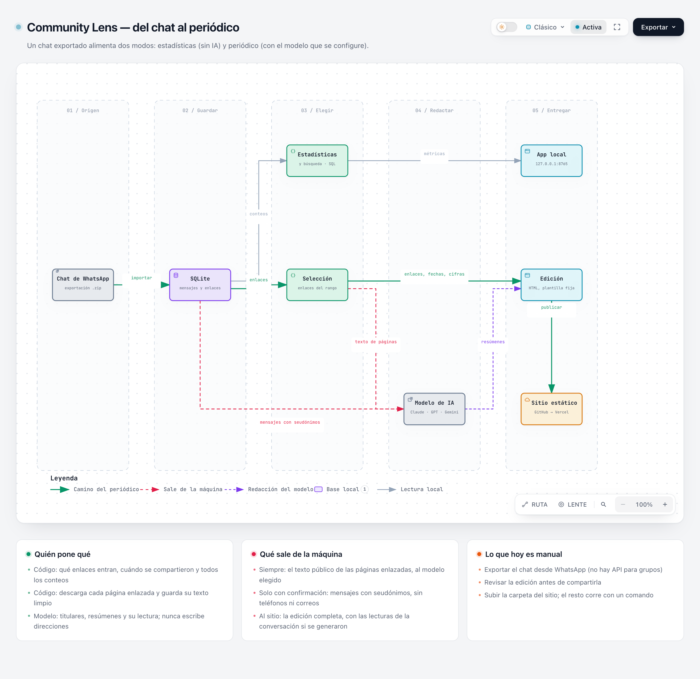

# Community Lens

App local para entender el historial de una comunidad a partir de una exportación de WhatsApp (`.zip` o `.txt`).
Corre en tu máquina, guarda todo en una base SQLite local y tiene dos usos:

- **Estadísticas y mensajes**: conteos reproducibles, búsqueda de texto completo, documentos y enlaces compartidos,
  categorías revisables y un reporte agregado. Funciona sin ningún modelo de lenguaje y sin enviar nada afuera.
- **Periódico**: una página para ponerse al día con lo que se compartió en un rango de fechas. Los enlaces, las
  fechas y las cifras salen del chat; los titulares y resúmenes los redacta el modelo que configurés.



## Arrancar

| Para | Hace falta |
|---|---|
| Correr la app | Python 3.11 o superior, con SQLite compilado con FTS5 (lo habitual). Internet solo la primera vez, para instalar las dependencias. |
| Generar el periódico | Además, la key de API de algún modelo en `.env` e internet. |
| Cambiar el frontend | Además, Node 22 o superior. Para usar la app no hace falta: el JavaScript compilado viene en el repo. |

```bash
./run.sh
```

Crea `.venv`, instala las dependencias (la primera vez y cuando cambie `requirements.txt`) y sirve la app en
**http://127.0.0.1:8765**. Se apaga con `Ctrl+C`. Probado en macOS; `run.sh` es un script de bash, así que en
Windows hay que usar WSL o hacerlo a mano:

```bash
python3 -m venv .venv
.venv/bin/pip install -r requirements.txt
.venv/bin/python -m community_lens
```

La configuración es opcional: `cp .env.example .env` y editar. Ese archivo documenta todas las variables; sin `.env`
todo funciona con los valores por defecto. `.venv/bin/python -m community_lens --help` muestra los comandos disponibles.

## Primer recorrido

**Exportar el chat.** En WhatsApp, abrí el grupo → menú del grupo → *Exportar chat*. WhatsApp pregunta si incluir
los archivos:

- **Sin archivos** (recomendado): un texto liviano, donde cada foto o audio figura como «imagen omitida».
- **Con archivos**: el mismo texto junto con las fotos, audios y documentos (normalmente en un `.zip`). La app
  solo lee el texto; los adjuntos se ignoran.

Las dos formas se pueden importar en el mismo grupo: un mensaje con adjunto se reconoce como el mismo en ambas.

**En la app** (las pestañas están agrupadas en *Estadísticas y mensajes*, *Periódico* y *Datos*):

1. **Importar chat** → elegí el archivo. Revisá el diagnóstico, el orden de fecha detectado (con su evidencia) y el
   grupo de destino sugerido. Reimportar el mismo archivo no duplica nada; una exportación más nueva del mismo
   grupo solo agrega lo que falta.
2. **Resumen** → métricas con su denominador, actividad por mes y por día, autores y dominios.
3. **Recursos** → buscá un documento por nombre: última versión, anteriores, quién lo compartió y dónde.
4. **Explorar** → buscá un término, filtrá por autor o categoría, abrí *Ver contexto* y probá *Copiar referencia*.
5. **Categorías** → ejecutá *Clasificar con reglas*, entrá a una categoría y corregí un mensaje.
6. **Reporte** → abrí o descargá el resumen agregado en HTML o texto.

## Generar el periódico

1. Poné en `.env` la key del modelo que tengás y reiniciá la app:
   - `ANTHROPIC_API_KEY` para Claude (el modelo es opcional), o
   - `OPENAI_API_KEY` **y** `OPENAI_MODEL` para GPT o cualquier API compatible (`OPENAI_BASE_URL`), o
   - `GEMINI_API_KEY` **y** `GEMINI_MODEL` para Gemini.

   En OpenAI y Gemini el nombre del modelo es obligatorio: una key sin modelo se ignora (la pantalla lo avisa).
   Con varias keys, "Automático" redacta con la primera de esa lista y, si falla, pasa a la siguiente.
2. En **Generar periódico** elegí el rango. Los atajos ("Última semana", etc.) cuentan hacia atrás desde el último
   día con mensajes del grupo, no desde hoy. Revisá qué enlaces entran y qué saldría de tu máquina, y generá.
3. La edición queda guardada: se abre en el navegador o se descarga como un solo archivo HTML.

Sin pantalla, para automatizarlo:

```bash
.venv/bin/python -m community_lens periodico --archivo export.zip --grupo "Mi comunidad" --salida sitio/
```

Importa la exportación, genera la edición de los 7 días que terminan en el último día con mensajes y escribe
`sitio/index.html` más una página por edición en `sitio/ediciones/`. Es solo HTML: se sube a cualquier hosting
estático. Lo que subás es la edición completa: si generaste lecturas de la conversación, van incluidas. `.venv/bin/python -m community_lens periodico --help` lista todas las opciones (rango, modelo, lecturas de la
conversación, publicar sin generar). Más detalle en [docs/periodico.md](docs/periodico.md).

## Privacidad

La app escucha solo en `127.0.0.1` y no tiene autenticación: no cambiés `CL_HOST` en una red compartida.
Esto es todo lo que sale de tu máquina, y cuándo:

| Qué hacés | Qué sale | Hacia dónde |
|---|---|---|
| Importar, estadísticas, búsqueda, recursos, reporte, clasificar con reglas | Nada | — |
| Clasificar con Jev (apagado por defecto; pide confirmación en cada ejecución) | El texto de cada mensaje a clasificar y el de hasta `JEV_CONTEXT_MESSAGES` mensajes previos (2 por defecto) | `api.typesafe.ai` |
| Generar una edición del periódico | Una solicitud a cada página enlazada, desde tu máquina; el texto público de esas páginas | Los sitios enlazados; el modelo que redacta |
| Pedir además una "lectura de la conversación" (casilla de confirmación aparte) | Los mensajes del rango con seudónimos (P01, P02…), sin teléfonos, correos ni menciones. Un nombre escrito dentro de un mensaje sí puede ir | Cada modelo marcado |

Las keys se leen de `.env`, no se registran y nunca llegan al navegador. **Eliminar grupo y datos** (en *Importar
chat*) borra todo lo derivado de ese grupo, incluidas sus ediciones y el texto de las páginas que se leyeron para
ellas; tus archivos originales no se tocan. El resto está en [docs/seguridad.md](docs/seguridad.md).

## Limitaciones

- Los resúmenes del periódico son automáticos y no se verifican contra los artículos: revisá la edición antes de
  compartirla. Las páginas que dependen de JavaScript o de sesión iniciada no se pueden leer, y la regla que
  separa artículo, red social y sitio es simple (dominio y ruta): puede clasificar mal un enlace.
- OpenAI y Gemini están implementados y probados con respuestas simuladas, pero no contra el servicio real
  (Claude sí).
- El TXT de WhatsApp no trae IDs de mensaje, reacciones, respuestas citadas, adjuntos ni lista de miembros.
  No existen enlaces para abrir un mensaje en WhatsApp.
- Las horas son las del teléfono que exportó. Dos exportaciones del mismo chat hechas en zonas distintas necesitan
  que declarés la zona de cada una para reconciliarse.
- La reconciliación compara hora, autor y texto. Si dos teléfonos muestran al mismo autor de forma distinta
  (contacto en uno, teléfono en otro), la app lo detecta como baja coincidencia y pide confirmación, pero no los
  empareja sola. Un mensaje editado o eliminado entre dos exportaciones queda dos veces, marcado para revisión.
- Reconocer el mismo mensaje entre una exportación con archivos y una sin archivos está probado con datos
  sintéticos en el formato de iOS (`<attached: …>`), no con exportaciones reales de cada plataforma. Un documento
  puede figurar distinto en cada una; en ese caso queda dos veces, marcado para revisión.
- "Autores" son identificadores tal como aparecen en el archivo, no personas. Las estadísticas describen actividad
  visible en el grupo: no permiten inferir intenciones ni quién originó una idea, y "sin seguimiento visible" no
  significa que no hubo seguimiento por privado.
- Las categorías son estimaciones (reglas simples o un modelo), no conteos oficiales.

## Desarrollo

Pruebas, dependencias y cómo proponer un cambio: [CONTRIBUTING.md](CONTRIBUTING.md).

## Documentación

| Documento | Contenido |
|---|---|
| [docs/periodico.md](docs/periodico.md) | Cómo se arma una edición, qué decide el código y qué el modelo, línea de comandos, formato guardado |
| [docs/arquitectura.md](docs/arquitectura.md) | Módulos, modelo de datos, parser, reimportaciones y solapes, qué cubre cada archivo de pruebas |
| [docs/metricas.md](docs/metricas.md) | Definición y denominador de cada métrica |
| [docs/clasificacion.md](docs/clasificacion.md) | Categorías, proveedores (reglas, Jev), ejecución vigente y correcciones humanas |
| [docs/seguridad.md](docs/seguridad.md) | Qué se guarda, qué se registra, cómo se trata el contenido del chat y las páginas enlazadas |
| [docs/frontend.md](docs/frontend.md) | TypeScript sin framework, contrato de tipos con la API, gráficos |
| [docs/diagramas/README.md](docs/diagramas/README.md) | Los diagramas de flujo de datos y cómo regenerarlos |
| [Issues](https://github.com/stern9/community-lens/issues) | Lo que falta por hacer y las decisiones abiertas |

## Créditos y licencia

El formato de periódico y la idea de que un modelo lea las páginas y arme la portada vienen de
[ai-newtab](https://github.com/ThariqS/ai-newtab) de Thariq (`ThariqS`, licencia MIT); aquí no se usa su código.
Los gráficos usan [Observable Plot](https://observablehq.com/plot/) y D3 (licencia ISC), copiados en `web/vendor/`.
Los diagramas están hechos con [Archify](https://github.com/tt-a1i/archify) (licencia MIT).

Community Lens se publica bajo la [licencia MIT](LICENSE). Las librerías copiadas en `web/vendor/` conservan la suya
(ver [web/vendor/README.md](web/vendor/README.md)).

[@stern9](https://github.com/stern9): 🤖 Generated with [Claude Code](https://claude.com/claude-code) (Claude Opus 5.5) · ☀️ Y Sol contraataca, desde [Codex](https://openai.com/codex/).
