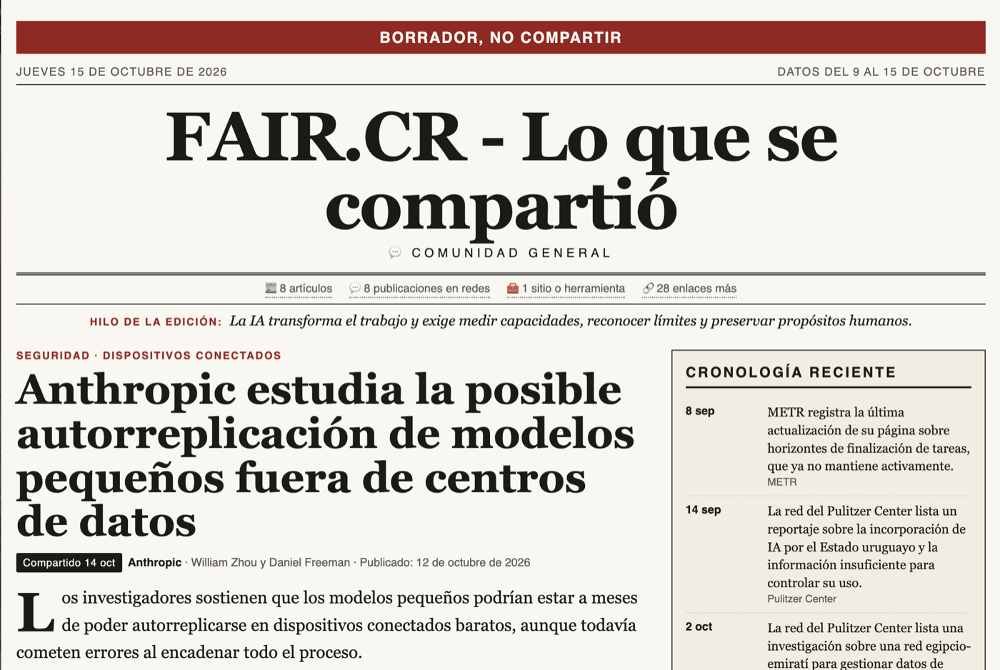

# El periódico

Una edición es una página para ponerse al día con lo que la comunidad compartió en un rango de fechas.
El diagrama [`diagramas/periodico.html`](diagramas/periodico.html) muestra el recorrido completo (en la app:
"Cómo se arma ↗", junto a "Generar periódico").

## Quién produce cada parte

| Parte | Quién la produce |
|---|---|
| Qué enlaces entran, fecha en que se compartieron, conteos de mensajes y participantes | Código, desde SQLite |
| Qué cuenta como "el mismo enlace" | Código: una sola regla (`resources.link_key`) |
| Tipo de enlace (artículo, red social, sitio) | Regla fija por dominio y ruta |
| Titulares, resúmenes, cronología, "hilo de la edición" | El modelo, leyendo el texto de cada página |
| Qué artículo encabeza | Código, si uno se compartió más veces que todos los demás (al menos 2); si no, el modelo |
| "Otros enlaces compartidos": lo que pasa del tope | Código: titular de la página (limpio), dominio, fechas; de una publicación, lo que publica la plataforma. Sin modelo |
| Lectura de la conversación (opcional) | El modelo, sobre mensajes seudonimizados |
| Mensajes por tema dentro de esa lectura | Código, contando la agrupación que hizo el modelo |
| Qué queda fuera del sitio: lecturas, "En números", nombre del grupo | Código: la versión pública (ver "Versión pública") |

- **El modelo nunca escribe direcciones.** Se refiere a cada enlace por un número y el código pone la URL. Un
  número que no existe se descarta, así que una edición solo enlaza a lo que se compartió en el chat.
- **Identidad de un enlace.** El mismo enlace compartido con y sin `www.` o `m.`, con o sin barra final, o con
  parámetros de seguimiento es un solo enlace con varias compartidas, tanto en Recursos como en el periódico. Primero
  se agrupa y se cuenta; después se decide el tipo. La dirección que se muestra es la del chat, sin esos parámetros:
  `utm_…`, `fbclid`, `gclid` e `igsh` en cualquier sitio, y los propios de cada red (`si` de YouTube y Spotify, `s` y
  `t` de X, `rcm` de LinkedIn, `u_code` de TikTok, `xmt` de Threads…), varios de los cuales identifican a quien
  compartió. Un nombre como `si` o `t` solo se quita en la red donde es seguimiento: en otro sitio puede ser parte de la
  dirección. La lista está en `resources._TRACKING_BY_SITE`. La plantilla los quita también al dibujar, así una edición
  guardada antes de este cambio tampoco los muestra (una aprobada hay que reaprobarla: se publican sus bytes).
- **Lectura de páginas.** Se descargan desde tu máquina y su texto limpio se guarda en la tabla `pages`, bajo la
  identidad del enlace, para no volver a descargarlas. Si un artículo no se puede leer (muro de pago, enlace caído)
  entra el siguiente del rango y el que falló queda listado en "No se pudo leer".
- **Redes sociales.** Solo se obtiene lo que cada plataforma publica para incrustar o para vistas previas (texto del
  post, título del video). A Instagram y Facebook se les pide como herramienta (`META_UA`, sin hacerse pasar por
  ningún rastreador), porque a un navegador sin sesión no le entregan esa ficha; Facebook recorta el texto y la
  edición se lo avisa al modelo. Si la plataforma no entregó nada (cuenta privada, publicación borrada), el enlace no
  ocupa una tarjeta: va en la línea "También se compartió", con la red y la fecha, sin texto inventado; lo mismo un
  sitio sin texto legible. Cada red lleva su logo, de Simple Icons (`community_lens/brand_icons.py`); LinkedIn no está
  ahí y su ícono está dibujado en ese mismo archivo (`DRAWN`).
- **Plantilla fija** (`community_lens/newspaper_html.py` y `newspaper.css`): un HTML sin scripts ni recursos externos.

## Reglas de una edición

Las aplica `community_lens/newspaper.py`, igual para la pantalla y para la línea de comandos:

- **Rango.** Fechas `AAAA-MM-DD` válidas y en orden. Lo que falte se completa: termina el último día con mensajes
  de participantes (los avisos del sistema posteriores no cuentan) y cubre 7 días contando ese.
  Con `--continuar` (solo en la línea de comandos) el rango sale de las ediciones ya guardadas: empieza el día siguiente
  al fin de la última edición del grupo y termina el último día **completo**, el anterior al último día con mensajes
  (ese suele estar a medias cuando se exporta). Sin ediciones previas, cubre los 7 días que terminan en ese último día
  completo. Así la frecuencia es simplemente cada cuánto llega una exportación: exportar cada semana, saltarse una o
  exportar dos veces seguidas no deja días sin cubrir ni días repetidos. Si no hay días nuevos (por ejemplo, la misma
  exportación otra vez), responde "sin novedad" sin llamar al modelo. Si el rango trae menos de 3 artículos, no
  genera, lo dice y el material se acumula para la próxima corrida. "La última edición" es la última **aprobada o
  heredada** (ver "Borrador, aprobación y publicación"): un borrador todavía no cuenta y una descartada deja de
  contar: si era la que llegaba más lejos, su período se vuelve a cubrir. Si el grupo tiene un borrador sin aprobar ni descartar, `--continuar` no genera otro encima: termina con
  código 3 y lo nombra (después de mirar si hay días nuevos, así la misma exportación otra vez sigue siendo "sin
  novedad"). Una edición aprobada que se hizo desde la pantalla termina en el último día con mensajes, que suele estar
  a medias, así que mezclar las dos formas puede dejar la tarde de ese día sin cubrir.
- **Artículos.** De 3 a 15 con resumen (8 por defecto). Un número fuera de ese rango se rechaza; no se corrige en
  silencio. Se leen hasta 4 artículos de reserva por si alguno falla. Redes sociales: hasta 8 con ficha. Sitios: hasta
  8. Lo que pasa de esos topes no se pierde: va al final, en "Otros enlaces compartidos", agrupado por tipo, con los
  primeros 5 de cada grupo a la vista y el resto en "Ver N más" (`<details>`, sin JavaScript). Cada enlace lleva arriba
  el medio (o la red y la cuenta) y la fecha en que se compartió, y abajo el titular en dos líneas a lo sumo:
  - **Artículos y sitios:** el `og:title` de la página o su `<title>` (solo el de la página, no los de sus íconos), sin
    la cola que repite el medio (" | La Nación"; un guion se recorta solo si lo que sigue es el medio). Si no se pudo
    leer, el dominio en gris.
  - **Publicaciones:** lo que la plataforma publica para incrustar (texto del post, título del video) y la cuenta; si
    no entregó nada, "Publicación en …" en gris.
  - **Nota vieja:** si la página declara su fecha (`article:published_time`; nunca se adivina) y es de más de 30 días
    antes de compartirse, una marca "nota de 2022".

  Esas páginas y publicaciones se descargan como las demás (y quedan en `pages`), pero nada de eso va al modelo. La
  edición avisa cuántos artículos fueron a la lista.
- **Artículo principal.** Encabeza el que se compartió más veces en el chat, si supera a todos los demás y se compartió
  al menos dos veces; lo cuenta el código. Si no (lo común: casi todo se comparte una vez), lo elige el modelo con un
  criterio fijo: el de más relevancia para la comunidad o el que mejor representa el hilo de la edición.
- **Modelos.** "Automático" redacta con el primer proveedor configurado que responda (Claude, OpenAI, Gemini, en ese
  orden) y la edición guarda cuál redactó y cuál falló. Un proveedor elegido por nombre no cae a otro.
- **Lecturas de la conversación.** Envían texto del chat (con seudónimos), así que exigen una confirmación explícita.

## Línea de comandos

```bash
.venv/bin/python -m community_lens periodico --archivo export.zip --grupo "Mi comunidad" --salida sitio/
.venv/bin/python -m community_lens periodico --help
```

| Opción | Para qué |
|---|---|
| `--archivo` | Exportación a importar antes de generar. Volver a pasar el mismo archivo no duplica nada |
| `--carpeta` | En lugar de `--archivo`: importa la exportación `.zip` o `.txt` más nueva (por fecha de modificación) de esa carpeta, sin entrar en subcarpetas ni mirar archivos ocultos, e imprime cuál eligió. No borra ni mueve nada. Exige `--grupo-id` o `--grupo` |
| `--grupo` / `--grupo-id` | Grupo por nombre exacto o por id. Si dos grupos se llaman igual, el comando se detiene y los lista: hay que usar `--grupo-id` |
| `--dias`, `--desde`, `--hasta` | Rango de la edición (ver "Reglas") |
| `--continuar` | Cubre desde el día siguiente a la última edición aprobada hasta el último día completo; "sin novedad" si no hay días nuevos, no genera con menos de 3 artículos y no genera si queda un borrador pendiente (ver "Reglas"). No se combina con `--dias`, `--desde` ni `--hasta` |
| `--articulos`, `--orden` | Máximo de artículos y prioridad (`recent` o `shared`) |
| `--modelo` | `anthropic`, `openai` o `gemini`; sin esta opción, automático |
| `--lecturas … --confirmo-enviar-chat` | Lecturas de la conversación (`todos` o una lista); sin la confirmación no se envía nada |
| `--salida` | Carpeta del sitio estático: `index.html` y `ediciones/<desde>_a_<hasta>.html` (la aprobada o heredada más reciente de cada rango). Una edición recién generada sin `--aprobar` no entra, y el comando lo dice |
| `--solo-publicar` | No genera: reescribe el sitio con las ediciones aprobadas y heredadas |
| `--borrador RUTA.html` | Escribe la vista previa: la versión pública (la que se publicaría) con la banda "Borrador, no compartir", de la edición recién generada o de `--edicion N`. Es lo que aprueba quien revisa. Crea la carpeta si falta. No toca el sitio |
| `--edicion N` | Actúa sobre la edición N (tiene que ser del grupo indicado) en lugar de generar: con `--aprobar`, `--descartar`, `--recuperar` o `--borrador`. No importa, no llama al modelo ni descarga páginas. No se combina con `--archivo`, `--carpeta`, `--continuar`, `--dias`, `--desde` ni `--hasta` |
| `--aprobar --aprobado-por TEXTO --canal TEXTO` | Aprueba `--edicion N` (borrador, heredada o aprobada otra vez) o, al generar, la recién generada. Quién y por qué canal son obligatorios. Al generar es **solo para uso manual, nunca en un guion programado**: aprobaría sin que nadie vea el borrador |
| `--destino TEXTO` | Con `--aprobar`: adónde se publica; por defecto, la ruta de `--salida` si se pasó; sin ninguna de las dos, no se registra destino |
| `--descartar` / `--recuperar` | Con `--edicion N`: la oculta y la saca del sitio en la próxima publicación / una descartada vuelve a borrador |
| `--listar` | Imprime las ediciones del grupo, una por línea: id, rango, estado, quién y cuándo aprobó y si está en el sitio. No se combina con otras acciones ni con la generación |
| `--json` | Imprime en la salida estándar un solo objeto JSON con el resultado (`status`, `detail`, `import`, `edition`, `warnings`, `site`, `draft`); los mensajes para personas van a la salida de error. `edition` tiene la forma de una fila de la lista de ediciones (estado, aprobación, `hash_ok`, `up_to_date`, `leaks_readings`, `blocked_reason`, `in_site`, lo enviado) y, al generar, los conteos; `site` trae `skipped`, las ediciones que no se escribieron y por qué; `draft`, la ruta de `--borrador`; `--listar` agrega `editions`. `status` vale `generada`, `publicada`, `aprobada`, `descartada`, `recuperada`, `vista_previa` (solo `--borrador`), `listado`, `sin_novedad`, `material_insuficiente`, `borrador_pendiente` o `error`. Nunca incluye texto de mensajes. Con código 2 no hay JSON: argparse rechaza los argumentos antes de que exista un resultado |

Códigos de salida, para que un guion decida sin leer los mensajes:

- **0**: hecho: se generó la edición, se aplicó la acción sobre `--edicion` (o se escribió su vista previa), se
  escribió el sitio con `--solo-publicar` o se listaron las ediciones.
- **1**: algo falló y hay que mirar: fecha inválida, grupo ambiguo, sin modelo configurado, falló el modelo, archivo
  inexistente, carpeta sin exportaciones, carpeta sin permisos, base bloqueada, `--edicion` de otro grupo… Si falló
  después de generar, la edición ya quedó guardada como borrador y el mensaje dice cómo aprobarla y publicarla.
  También es 1 si una edición no se escribió en el sitio (una aprobada cuyos bytes no coinciden con su hash, una
  aprobada antes de la versión pública o con lecturas en sus bytes, o una guardada que esta versión no sabe leer): el sitio se escribe igual con las demás, `detail` dice cuántas faltan con
  el motivo de cada una y `site.skipped` las lista.
- **2**: argumentos mal usados o contradictorios (`--continuar` con un rango explícito, `--carpeta` con `--archivo` o
  sin `--grupo-id` ni `--grupo`, `--solo-publicar` sin `--salida` o con `--continuar`, `--edicion` con opciones de
  generación o sin acción, `--aprobar` sin `--aprobado-por` o `--canal`, o con alguno vacío, de solo espacios o más
  largo de lo que se guarda (200 caracteres quién y canal, 500 el destino), esos datos sin `--aprobar`, dos acciones
  juntas, `--descartar` o `--recuperar` sin `--edicion`). No toca la base y, aun con `--json`, no imprime JSON: solo el
  mensaje de uso en la salida de error.
- **3**: nada que publicar esta vez: "sin novedad" (no hay días nuevos), material insuficiente o, con `--continuar`,
  un borrador pendiente (`borrador_pendiente`: el mensaje nombra el más nuevo, cuántos hay y cómo aprobarlo o
  descartarlo). Se imprime como aviso y **no reescribe el sitio** aunque se pase `--salida`; para reescribirlo igual
  está `--solo-publicar`.

### Borrador, aprobación y publicación

Toda edición recién generada, desde la pantalla o desde el comando, queda como **borrador**: no entra al sitio hasta
que alguien la revisa y la aprueba. Los estados (`editions.status`, definidos en `community_lens/edition.py`):

- **borrador**: recién generada, o recuperada. No se publica; su página lleva la banda "Borrador, no compartir".
- **aprobada**: alguien la aprobó. Al aprobar se dibuja una sola vez su versión pública, sin banda, y se guardan esos **bytes exactos**
  (`editions.approved_html`) junto con su sha256 como registro de integridad, quién aprobó, por qué canal, cuándo
  (UTC) y adónde se publica (`editions.approval`). Aprobar de nuevo reemplaza bytes y registro; no hay historial.
- **descartada**: oculta y fuera del sitio. Recuperarla la vuelve a borrador sin borrar su registro de aprobación.
- **heredada**: guardada antes de que existiera la aprobación. Se sigue publicando como siempre, dibujándola, sin hash;
  se puede aprobar (pasa a aprobada) o descartar.



`publish()` (`--salida`, `--solo-publicar`) escribe, de cada rango, la aprobada o heredada más reciente. De una
aprobada escribe los bytes guardados **tal cual**, después de comprobar que siguen coincidiendo con su hash; nunca la
vuelve a dibujar. Después borra de `ediciones/` las páginas de rango (`AAAA-MM-DD_a_AAAA-MM-DD.html`) que no escribió
en esa corrida, así una descartada no sigue en la carpeta que se sube; cualquier otro archivo queda. Por eso un cambio
de plantilla o de estilos no cambia lo publicado hasta reaprobar: la lista de "Ediciones guardadas" lo informa ("hay
plantilla nueva: reaprobá para actualizarla"). Si los bytes de una aprobada ya no coinciden con su hash (alguien los
cambió por fuera), es un error: no se escribe, su rango sale del sitio (no vuelve una aprobada más vieja), la lista
la marca como dañada y el comando termina con código 1.

En la pantalla, cada edición de "Ediciones guardadas" muestra su estado y sus acciones: "Aprobar…" pide quién y por
qué canal, "Descartar", "Recuperar"; las descartadas se ocultan hasta pedirlas. `/periodico/<id>` muestra la banda en
un borrador o una descartada, y `/periodico/<id>?borrador=1` la fuerza en cualquier estado, para mandar a revisar de
nuevo una aprobada sin cambiarle el estado; con banda, la descarga se llama `borrador_<desde>_a_<hasta>.html`.
Eso es la edición completa, para quien corre la app. `/periodico/<id>?publico=1` (el enlace "Versión pública" de cada
fila y de "Edición lista") muestra la versión pública, la que se publicaría, con banda según el estado; se combina con
`?borrador=1`, y `?publico=1&borrador=1` es byte a byte lo que escribe `--borrador`. Sus descargas se llaman
`publico_…` y `borrador_publico_…`.

Sin pantalla, la receta es de dos comandos: el programado deja el borrador y su vista previa en una carpeta
compartida, y cuando quien administra el grupo dice "publicar", una persona corre el segundo.

```bash
# programado: importa, genera el borrador y deja la vista previa en la carpeta compartida
.venv/bin/python -m community_lens periodico --carpeta <dir> --grupo-id N --continuar --borrador <dir>/borrador.html --json
# a mano, cuando llega la aprobación (el id sale del JSON anterior o de --listar)
.venv/bin/python -m community_lens periodico --grupo-id N --edicion 12 --aprobar --aprobado-por "Jaime" --canal WhatsApp --salida sitio/
```

`--aprobar` también se puede pasar al generar, para aprobar al vuelo la edición recién generada. Es **solo para uso
manual, nunca en un guion programado**: aprobaría una edición que nadie vio.

#### Versión pública

El sitio lleva solo la versión pública de cada edición; la pantalla y `/periodico/<id>` siguen mostrando la completa.
Criterio: sale todo lo que describe la **conversación** y queda lo que viene de las **páginas enlazadas**, que el
modelo redactó sin ver ningún mensaje. Es la misma plantilla (`newspaper_html.render(…, public=True)`), no una copia.

| Elemento | De dónde sale | Versión pública | Por qué |
|---|---|---|---|
| Lecturas de la conversación (sección `id="lecturas"`) | Mensajes seudonimizados | Fuera | Resumen una conversación privada |
| "En números" (mensajes, participantes, día más activo) | SQL sobre el chat | Fuera, la caja entera | Describe la actividad del grupo y no hace falta para leer la edición. Se sigue guardando en `data` para la pantalla |
| Nombre del grupo (`<title>`, subtítulo, `index.html`) | Nombre del chat en WhatsApp | Fuera | Identifica un grupo privado; el dominio donde se publica ya dice de qué comunidad es |
| Pie: "Los enlaces y las cifras salen del chat exportado" | Plantilla | Pasa a "Los enlaces y las fechas en que se compartieron salen del chat exportado" | Ya no hay cifras |
| "Compartido 2 oct", rango de la edición, fecha de creación | Fechas del chat y de la edición | Queda | Es la razón de ser del periódico; no nombra a nadie |
| Cuenta de una publicación en redes | La plataforma, al leer la ficha pública del post | Queda | Viene de la página, no del chat |
| Quién redactó | Configuración | Queda | No es dato del grupo |
| Nombre público del periódico (`CL_PERIODICO_NOMBRE`, en `<title>`, título e `index.html`) | Configuración | Queda, si está configurado: "FAIR.CR - Lo que se compartió" | Lo elige quien publica; no es el nombre del grupo de WhatsApp. Cambiarlo no toca lo ya aprobado: hay que reaprobar |
| Subtítulo público (`CL_PERIODICO_SUBTITULO`, bajo el título de cada edición y de `index.html`) | Configuración | Queda, si está configurado: "Comunidad General". Sin él, la versión completa muestra ahí el nombre del grupo y la pública nada | Igual que el nombre público |
| Enlaces: la URL tal como se compartió, sin parámetros de seguimiento (`utm_*`, `si=`, `igsh=`, `fbclid`…) | El chat | Queda | Es el contenido del periódico. Los parámetros de seguimiento salen porque varios identifican a quien compartió |
| Titulares, resúmenes, hilo, cronología, fichas de redes y sitios | El modelo sobre las páginas, o cadenas fijas del código | Queda | No sale de ningún mensaje |
| "No se pudo leer" (con el motivo: "HTTP 404"…) | Código | Fuera: esos enlaces van a "Otros enlaces compartidos" con su dominio | El motivo es jerga para quien lee; sirve a quien revisa |
| Cabecera "Datos del …" | Plantilla | Pasa a "Enlaces del …" | La versión pública no lleva datos del chat |
| "Otros enlaces compartidos" | Los enlaces del chat, con el titular y la fecha de publicación de su página o lo que publica la plataforma | Queda | Son enlaces y fechas, igual que el resto; no lleva cuántas veces se compartió cada uno. El conteo de cada grupo es de enlaces, no del chat |

Sin cronología, la versión pública no tiene columna lateral y la rejilla pasa a una columna. La barra de secciones
nunca tuvo entrada de lecturas (solo artículos, redes y sitios), así que ahí no hay nada que quitar.

Las aprobadas antes de la versión pública tienen congelada la edición completa (nombre del grupo, "En números" y, si
las tenían, lecturas), así que **hay que aprobarlas de nuevo**: hasta entonces no entran al sitio y `publish()` borra
su página de la carpeta local, pero la copia ya subida al hosting sigue ahí hasta que volvás a subir la carpeta. La
lista de "Ediciones guardadas" y `--listar` las muestran con su motivo ("aprobada antes de la versión pública:
reaprobala para publicarla", o "contiene lecturas de la conversación: reaprobala para publicarla" si sus bytes llevan
la sección de lecturas), el mismo texto que trae `blocked_reason` en la fila, y el comando termina con código 1 con
ese motivo en `site.skipped`. Las heredadas no hacen falta: se
dibujan en su versión pública al publicar.

#### Publicar en GitHub Pages

El sitio es HTML estático, así que cualquier hosting sirve. Con GitHub Pages en un repositorio público, la forma que no
mezcla el sitio con el código es una rama `gh-pages` sin historia común con `main`, en su propia carpeta:

```bash
git worktree add --orphan -b gh-pages ../sitio-gh-pages   # una sola vez
touch ../sitio-gh-pages/.nojekyll                          # que GitHub sirva los archivos tal cual

# cada edición: aprobar escribiendo el sitio en esa carpeta, y subirlo
.venv/bin/python -m community_lens periodico --grupo-id 1 --edicion N --aprobar --aprobado-por "…" --canal "…" --salida ../sitio-gh-pages
git -C ../sitio-gh-pages add -A && git -C ../sitio-gh-pages commit -m "publicar: edición del …" && git -C ../sitio-gh-pages push -u origin gh-pages
```

Pages se activa en *Settings → Pages* con la rama `gh-pages` y la carpeta raíz (al subir esa rama por primera vez,
GitHub suele activarlo solo). `publish()` solo reescribe `index.html` y `ediciones/`: el `.git` y el `.nojekyll` de la
carpeta quedan. Cada publicación es un commit, así que queda el historial de qué se publicó y cuándo. Para un
dominio propio, un archivo `CNAME` en esa rama y el registro CNAME en el DNS del dominio.

### Programarlo

Dejá cada exportación en una carpeta (AirDrop, iCloud, correo) y corré, cada cierto tiempo:

```bash
.venv/bin/python -m community_lens periodico --carpeta <dir> --grupo-id N --continuar --borrador <dir>/borrador.html --salida sitio/ --json
```

El guion **nunca pasa `--aprobar`**: deja el borrador para que una persona lo revise y lo apruebe con
`--edicion N --aprobar` (ver "Borrador, aprobación y publicación"). Con 0, avisa que hay un borrador para revisar y
sube `sitio/`, que solo lleva lo ya aprobado; con 3, no hace nada (la misma exportación otra vez termina en "sin
novedad" sin llamar al modelo, el material insuficiente se acumula para la próxima y un borrador pendiente espera su
aprobación; ojo: con 3 `borrador.html` no se reescribe y puede mostrar uno viejo); con 1, avisa a alguien. Un guion programado fija
siempre `--grupo-id`: sin grupo, el grupo sale del nombre del archivo y, si una exportación llega con otro nombre,
se crearía un grupo nuevo; un nombre con `--grupo` deja de servir si otro grupo pasa a llamarse igual.

Con cron (`crontab -e`), los lunes a las 8, desde la carpeta del repositorio:

```
0 8 * * 1  cd <repo> && .venv/bin/python -m community_lens periodico --carpeta <dir> --grupo-id N --continuar --salida sitio/ --json >> periodico.jsonl 2>> periodico.log
```

En macOS, `launchd` hace lo mismo con un `.plist` en `~/Library/LaunchAgents/`. `ProgramArguments` no pasa por un
shell, así que no interpreta `cd … &&` ni redirecciones: ponele `WorkingDirectory` con la ruta del repositorio (o rutas
absolutas en cada argumento), `StandardOutPath` y `StandardErrorPath` para los dos archivos, y `StartCalendarInterval`
para el horario.

## Formato guardado

Una edición se guarda como JSON en `editions.data` y se dibuja de nuevo cada vez que se abre (y al publicarla, si es
heredada); así una mejora de la plantilla llega también a las ediciones viejas. De una aprobada se publican los bytes
guardados al aprobarla (ver "Borrador, aprobación y publicación"). `community_lens/edition.py` es el único lugar que
conoce sus campos: los declara, lleva un número de formato (`FORMAT`) y tiene una sola función, `upgrade()`, que
convierte cualquier edición guardada con una forma anterior a la actual. Abrir una edición vieja no la reescribe.
La columna `editions.html`, de una versión anterior, no se lee (ver [arquitectura.md](arquitectura.md#modelo-de-datos)).

El formato de periódico se inspira en ai-newtab (créditos en el [README](../README.md#créditos-y-licencia)); aquí
no se usa su código: la lectura se hace en Python y el diseño es una plantilla, para que cada edición salga con la
misma forma.
